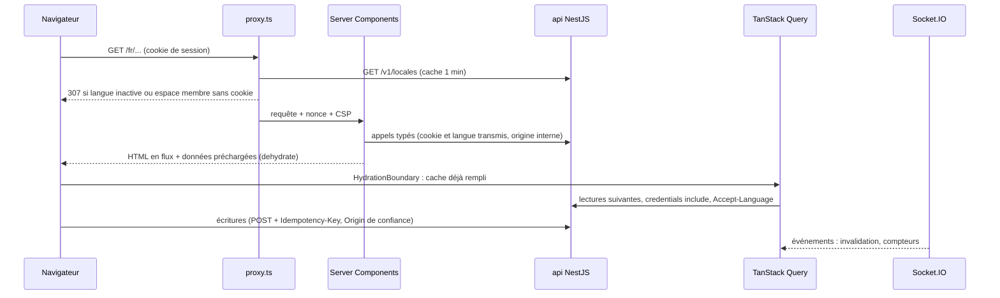

# Frontend (`apps/web`)

Application Next.js 16 (App Router) qui consomme l'api par `@pitchorium/api-client`, les contrats de `@pitchorium/contracts` et les textes de `@pitchorium/i18n`. Elle ne porte aucune règle métier : l'api décide, le web affiche et appelle. Décisions : ADR 0081 à 0091.

## Arborescence

```text
apps/web/
  src/
    app/
      [locale]/
        (marketing)/   pages publiques éditoriales (accueil provisoire)
        (auth)/        connexion, inscription, vérification, réinitialisation, double authentification, `/continue`, onboarding (ADR 0104)
        (app)/         espace membre (session exigée, temps réel)
        (public)/      une adresse par ressource (ADR 0101) : membre, organisation, projet, vitrine, événement ; cadre selon la session
        (admin)/       console d'administration (modérateur ou administrateur)
        (dev)/         outils de développement (santé de l'api), 404 en production
        layout.tsx     document : langue, polices, thème, fournisseurs
        not-found.tsx, error.tsx, [...rest]/page.tsx
      sitemap.ts, robots.ts, manifest.ts, global-error.tsx, not-found.tsx
    features/<domaine>/   un dossier par domaine, façade index.ts (access, content, discovery, identity, localization, marketing, media, messaging, network, notifications, organizations, profiles, projects, impact, dev)
    components/ui/        primitives du design system, sans métier
    components/motion/    primitives de mouvement et tokens
    components/brand/     logos générés depuis le kit
    components/layout/    coquilles des groupes (member/, admin/), mises en page, états (states/), fournisseurs
    lib/                  api, auth, query, realtime, i18n, sécurité, formats, observabilité
    i18n/                 routage, navigation, configuration par requête de next-intl
    config/               site, routes, SEO, redirections
    styles/               tokens.css, globals.css, polices
    proxy.ts              nonce et CSP, langue active, présence de session
  public/brand, public/fonts   sélection du kit de marque (pnpm brand:sync)
  e2e/                  Playwright et api simulée
  .storybook/           design system
```

## Flux de données



- Premier rendu : les Server Components lisent l'api avec `lib/api/server.ts` (origine `API_INTERNAL_URL`, cookie et `Accept-Language` de la requête entrante, et l'adresse du visiteur signée pour la limitation de débit de l'api, `X-Pitchorium-Client-Address`, ADR 0115, derrière `WEB_TRUST_PROXY_HOPS` proxys de confiance). Le membre courant est lu une fois par requête (`lib/auth/session.ts`).
- Messages du navigateur : chaque groupe envoie ses sous-arbres (`CLIENT_MESSAGES`) ; l'espace membre y ajoute ceux du fil et des suggestions (`discovery`, libellés de `reference`), pour construire une phrase de raison dans le navigateur aussi.
- Navigateur : `lib/api/browser.ts` configure le client généré (`credentials: include`, `Accept-Language`, une `Idempotency-Key` par POST, sauf clé fournie par l'appelant pour son intention). Toute réponse non 2xx devient une `ApiProblemError` (code RFC 9457, `X-Request-Id`) ; l'interface affiche `errors.<code>`.
- `QueryClient` (`lib/query/query-client.ts`) : données fraîches une minute (pas de nouvelle lecture juste après l'hydratation), conservées cinq minutes, pas de relecture au focus (le temps réel invalide), pas de nouvel essai sur une erreur 4xx, deux sur une erreur réseau ou 5xx, aucune mutation rejouée automatiquement. Un client par requête sur le serveur (`lib/query/server.ts`), un par onglet dans le navigateur ; fourni par les groupes qui lisent l'api depuis le navigateur (`DataProvider`).
- Écritures : jamais de Server Action métier ; le navigateur appelle l'api, qui vérifie l'origine (ADR 0021) et l'idempotence. Hors ligne, une écriture attend le réseau (ADR 0097) ; un message, une réaction ou un commentaire en attente sont gardés dans IndexedDB pour leur membre et rejoués à la prochaine ouverture (ADR 0102).
- Temps réel (`lib/realtime/realtime-provider.tsx`) : monté par l'espace membre pour un membre connecté ; charges utiles validées par les schémas des contrats ; compteurs écrits dans le cache, notifications et conversations invalidées ; compteurs relus après une reconnexion.
- État d'URL : `nuqs` (filtres, onglets, recherche), monté par les composants qui gardent un onglet ou un filtre dans l'adresse (`UrlStateProvider`) et par la coquille de l'administration.
- Flags : le web ne lit que leurs effets, dont les langues actives (`GET /v1/locales`, ou `activeLocales` de `GET /v1/me`).

## Authentification et onboarding (ADR 0104, 0105)

- Les écrans de `(auth)` lisent `GET /v1/auth-configuration` côté serveur (`lib/auth/configuration.ts`) : fournisseurs OAuth, Turnstile (script de Cloudflare chargé par ces seuls écrans, cadre permis par la CSP), versions des conditions. Le client Better Auth se charge au premier envoi ; `authCall` y ajoute le jeton Turnstile et lit le délai d'une limite.
- Toute connexion revient à `/continue?redirectTo=` (serveur) : conditions à accepter d'abord, puis la page demandée, validée sur la même origine (`lib/auth/redirect.ts`, aussi pour le proxy). Un nouveau compte passe par `/onboarding` (conditions, intention, profil minimum).
- Prérequis : `PrerequisiteGateProvider` (coquille membre) et `useWithPrerequisites` ouvrent le formulaire de chaque élément manquant puis rejouent l'action ; dialogue et formulaires chargés au premier refus. Les éléments viennent tous de l'api (ADR 0109) : l'entrée de l'administration et la bannière de double authentification lisent `GET /v1/me/prerequisites/trust.moderation.read`.
- Paramètres : `/settings/account`, `/settings/security`, `/settings/privacy` (confidentialité et réseau), `/settings/organizations` (« Mes organisations », aussi dans le menu du compte), `/settings/preferences`, `/settings/payouts` (versement et vérification, pour un membre qui a un volet entrepreneur), une adresse par section ; `(admin)` renvoie vers la sécurité un rôle privilégié dont l'api demande la double authentification.

## Profils, organisations et réseau (PROMPT FRONT 3)

- Pages : `/members/{handle}` et `/organizations/{slug}` (vue publique ou membre, ADR 0101 et 0113), `/members/{handle}/network` (listes du membre selon sa confidentialité), `/network` (invitations reçues et envoyées, suggestions, listes du membre, onglet dans l'adresse), `/network/profile-views`, `/network/invitations` (invitations d'organisation et d'équipe de projet en attente, réglées sans l'email, ADR 0149), `/organizations/new`, `/organizations/{slug}/manage`, `/invitations/{jeton}` (sans référent, jamais indexée).
- Features : `profiles` (page, édition en place, force, aperçu `MemberHoverCard`, volets comme formulaires de prérequis), `network` (relation et ses actions, listes paginées `useCursorList`, page du réseau, visites, `FollowButton`, partie réseau des paramètres), `organizations` (page, création, gestion, invitation, « Mes organisations »), `media` (envoi par le module media, `ImageCropDialog`, ADR 0111). `organizations` lit `profiles` et `network` est passé en emplacement par la page (`actions`) : aucun cycle entre features.
- Mises à jour optimistes avec retour arrière (ADR 0112) ; compteurs d'invitations lus dans la clé des compteurs, écrite par le temps réel.
- Référencement : JSON-LD `Person` et `Organization` sur les vues publiques, images Open Graph et X par ressource (`lib/seo/resource-share-image.tsx`), plan du site lu dans les listes publiques de l'api, `noindex` sur les vues membres, la gestion et les invitations.

## Fil, publications et médias (PROMPT FRONT 4)

- Pages : `/feed` (fil virtualisé, ADR 0121), `/posts/{id}` (`(public)`, vue publique indexable avec JSON-LD `SocialMediaPosting` et image de partage `next/og`, vue membre sinon, 404), `/saved` (`(app)`), section « Activité » des pages d'un membre et d'une organisation.
- Feature `content` : carte de publication partagée par le serveur et le navigateur (îlots clients : images, document, projet), actions d'un membre chargées en morceaux (menu et sélecteur de réactions au premier usage, commentaires, repartage et statistiques à l'ouverture), composeur chargé à l'ouverture (Tiptap, ADR 0119 ; photos allégées, ADR 0120 ; brouillon local, ADR 0122 ; aperçu de lien demandé au collage, ADR 0118). Limites des contrats recopiées dans `lib/limits.ts` (testées) : aucune constante des contrats ne fait entrer Zod dans le fil.
- Données : première page du fil, du profil ou de la publication lue par le serveur ; TanStack Query ensuite (`initialData`) ; réactions et commentaires en mutations gardées hors ligne (ADR 0102) ; tête du fil et `GET /v1/feed/newer` pour la pastille des nouveautés (ADR 0117) ; vues signalées par lots (`POST /v1/posts/views`, `keepalive`, ADR 0116).
- Visiteur : la carte sans actions ; la suite d'une activité est chargée au premier « Afficher plus » (vue visiteur légère, ADR 0094).

## Projets et impact (PROMPT FRONT 5A)

- Pages (`(public)`, une adresse par ressource, ADR 0101) : `/projects` (vitrine, filtres et tri dans l'adresse par `nuqs`, suite par curseur), `/projects/{slug}` (vue visiteur indexable avec JSON-LD `Article`, ADR 0128, et image de partage `next/og` ; vue membre ; aperçu de l'équipe pour un brouillon, `noindex`), `/projects/new` et `/projects/{slug}/edit/{étape}` (assistant, ADR 0131 ; l'aperçu a son segment `edit/preview`), `/projects/{slug}/manage` (gestion, équipe seule) ; `(marketing)` : `/impact/methodology` ; `(app)` : `/profile/impact` (évaluation du volet entrepreneur).
- Feature `projects` : règles d'affichage pures et testées dans `lib/` (état du financement, paliers et leur validation en direct, champs verrouillés, équivalent indicatif en FCFA exact, ADR 0130, liens de partage, étapes de l'assistant, JSON-LD) ; page projet en composants serveur avec îlots clients (actions d'un membre et dialogue d'intérêt chargés à la demande, façade vidéo, ADR 0129, partage) ; barre d'action mobile propre à la page (ADR 0132) ; étapes de l'assistant et onglets de la gestion chargés à la demande. Feature `impact` : page de la méthodologie, formulaire d'évaluation, état sans méthodologie publiée.
- Données : première lecture par le serveur (`readProject` : projet, suivi et parité du membre) ; écritures par le client de l'api (aucune Server Action) ; brouillon enregistré dans l'api 800 ms après la saisie et en quittant l'étape ; les erreurs RFC 9457 et leur raison par `useProblemText` ou `useApplyProblem`.
- Images : celles d'une page rendue par le serveur (héros, cartes de projet) passent par `getImageProps` de `next/image` dans un `` simple, sans le composant client de l'image ; un brouillon sert ses images par adresse présignée, hors de l'optimiseur.
- Liens avec l'existant : cartes `project_update` et projet rattaché cliquables dans le fil, section « Projets » du profil d'un membre, « Projets portés » d'une organisation, action « Créer un projet » du bandeau pour un membre qui a un volet entrepreneur, sélecteur de projet du composeur vers les vraies pages.

## Contributions et versement (PROMPT FRONT 5B)

- Pages : `/contributions/{id}/return` (`(app)`, retour du prestataire, adresse donnée par l'api, ADR 0137) ; `/contributions/{id}` (détail d'une contribution du membre : devis appliqué, taux et sa source, commission, frais, remboursements, « pas un reçu fiscal » ; un paiement en attente se reprend ou s'abandonne jusqu'à la fin de sa session, puis demande un nouveau devis) ; `/settings/payouts` (« Versement et vérification » : couverture, choix et changement du versement, KYC, ADR 0139 et 0140, aussi l'adresse de retour d'un onboarding hébergé) ; le parcours « Contribuer » s'ouvre sur la page projet (`?contribute=<étape>`, ADR 0136).
- Feature `payments` : règles d'affichage pures et testées dans `lib/` (présentation de chaque code de disponibilité, moyens disponibles et indisponibles, étapes du parcours, interrogation du retour, adresse de paiement, masquage, couverture, limites recopiées des contrats) ; entrée « Contribuer » chargée à la demande (`LazyContributeEntry`, composée par la page projet avec la vue de l'api), parcours et déclaration hors plateforme chargés à l'ouverture.
- Gestion d'un projet : onglets « Contributions » (tableau paginé, filtres par statut et par type dans l'api, export CSV), « Hors plateforme » (à confirmer ou refuser, déclaration par l'équipe) et « Soutiens », et bannière de l'état du versement, composés par la route depuis la feature `payments` (`ManagePayments`), chargés à l'ouverture de leur onglet.
- Données : options relues 500 ms après un changement de pays, de devise ou de montant (`usePaymentOptions`) ; devis relu de même (`useQuote`) ; contribution créée avec une `Idempotency-Key` par intention ; état du retour relu par `createPoller` ; aucun état de paiement dans le stockage du navigateur.

## Engagement (PROMPT FRONT 5B)

- Pages : `/dashboard` (menu du compte et panneau du téléphone ; tableau de bord du membre, ou d'une organisation qu'il dirige par `?organization=<slug>`, ADR 0141) et `/dashboard/time` (journal du temps partagé), dans `(app)`.
- Feature `engagement` : chiffres clés comptés en unités mineures, graphique en barres du design system (`BarChart`, ADR 0144) sur la série mensuelle de l'api, résumé par le total des douze mois de l'api (`givenLastTwelveMonths`) et le mois du pic, état vide qui mène aux projets, historique CSV, journal du temps (déclaration, confirmation, contestation) ; « Mes contributions » et les contributions hors plateforme du membre viennent de la feature `payments`, composées par la page.

## Messagerie et notifications (PROMPT FRONT 6)

- Pages (`(app)`) : `/messages` (layout à deux panneaux, liste lue par le serveur et gardée quand la conversation change ; filtre et recherche dans l'adresse), `/messages/{id}` (conversation lue par le serveur : état et 50 derniers messages), `/messages/new?to={handle}` (premier message : la conversation existante s'ouvre, sinon ce que sera le message selon `GET /v1/messaging/members/{handle}`), `/messages/requests` (ancienne adresse des emails, renvoie au filtre des demandes), `/introductions` et `/introductions/{id}`, `/notifications`, `/settings/messaging`, `/settings/notifications` ; `(auth)` : `/unsubscribe?token=` (désinscription d'un email, sans session, avec annulation).
- Feature `messaging` : fil par séquence (`lib/thread.ts` : fusion, écart, envois en attente, accusés), lignes et ancrage (`lib/thread-rows.ts`, `lib/anchor.ts`, ADR 0146), virtualisation au-delà de 150 lignes (TanStack Virtual chargé avec le premier long historique), envoi optimiste par la mutation gardée `message` (`useSendMessage` : identifiant client, file par conversation, nouvel essai ou retrait d'un envoi refusé, envois restaurés montrés après l'hydratation), composeur chargé après la page (`LazyMessageComposer`, brouillons ADR 0147, fichiers allégés et envoyés au module media au premier choix), menus chargés à la demande ; bannière de demande chargée avec la page, puisque peinte par le serveur (chargée à la demande, un clic sur « Accepter » arrivé avant son code était perdu : diagnostic du FRONT 8A). Entrées : `MessageButton` (profil, « Contacter » d'un projet), `IntroduceButton` (profil d'une connexion), « Envoyer en message » d'une publication par `SendAsMessageContext` (`lib/actions`) que fournit la coquille membre : la feature content n'importe pas la messagerie.
- Feature `notifications` : `NotificationsPage` (familles de l'api, suite au défilement, lu à l'ouverture, suppression optimiste, pastille des nouveautés, ADR 0148), `NotificationItem` (réponse à une demande de connexion ou à une introduction ; cible liée seulement vers une page livrée, `lib/target.ts`), `NotificationSettings` (grille par type et canal, rythme et moment des digests donnés par l'api), `Unsubscribe`.
- Temps réel (`lib/realtime`) : `realtime-bus.ts` (noms des événements recopiés des contrats, testés ; écoute `useRealtime`, émission `emitRealtime`), connexion chargée à l'inactivité, reprise progressive (1 à 30 s), canal fermé après une minute d'onglet masqué puis rouvert, et au retour compteurs, listes et conversation ouverte relus (`local:resumed`, rattrapage `afterSequence`). Les charges utiles passent les schémas des contrats, chargés dix secondes après la connexion ou aussitôt par le premier événement, ceux reçus pendant le chargement traités dans leur ordre (ADR 0168).
- Messages du navigateur : groupes `messaging`, `notifications` et `unsubscribe` de `CLIENT_MESSAGES`, posés par les pages (`ScopedMessages`) ; les entrées de la messagerie sont dans le groupe `member`.
- Budgets (`check:bundles`, kio Brotli) : conversation 223,6, liste 209,6, premier message 212,9, notifications 212,9, introductions 201,1, paramètres 210,8 et 211,5, désinscription (groupe `(auth)`) sous son budget ; filtres en `FilterButtons` (sans Radix ToggleGroup), composeur, bannière de demande, pièces jointes, menus, visionneuse et virtualiseur hors du premier chargement. Le fil passe de 224,3 à 225,8 (constantes des adresses et client de l'api), 9,7 % de marge.

## Recherche et découverte (PROMPT FRONT 7)

- Pages (`(public)`, une adresse pour le visiteur et le membre) : `/search` (requête, type et filtres dans l'adresse, `noindex` dès qu'une requête est posée), `/discover` et `/discover/{section}` (sections de l'api, première page par le serveur, suite à la demande).
- Feature `discovery` : `SearchPalette` (autocomplétion, groupes par type, surlignage `lib/search/highlight.ts`), `GlobalSearch` (déclencheur et raccourci seuls au premier chargement ; la palette composée par la coquille, `MemberPalette`, chargée à l'inactivité avec les actions rapides et leurs icônes), `SearchBrowser`, `SearchResults`, `ResultCard`, `DiscoverPage` ; règles d'adresse pures et testées (`lib/search-query.ts`) ; valeurs des contrats recopiées (`lib/kinds.ts`). Recherches récentes : `lib/search/recent-searches.ts`, effacées par `useSignOut`.

## Événements (PROMPT FRONT 7)

- Pages (`(public)`, une adresse par ressource) : `/events` (liste publique et indexable, « Mes événements » jamais indexé), `/events/{slug}` (vue visiteur indexable avec JSON-LD `Event`, ADR 0151, et image de partage ; vue membre ; brouillon pour ses organisateurs, `noindex`), `/events/new` et `/events/{slug}/edit` (membre, organisateurs) ; `(app)` : `/settings/calendar` (ADR 0153).
- Feature `events` : règles pures testées dans `lib/` (état de l'inscription, places restantes, lien Google Agenda et carte, JSON-LD, adresse des filtres, limites recopiées des contrats) ; page en composants serveur, inscription, participants et actions des organisateurs en îlots chargés pour un membre seulement ; formulaire chargé après la page (schéma et Zod à l'inactivité) ; image par `ImageCropDialog` au format `event_image` (16:9).
- Fil : `EventFeedCard` (feature `content`) pour les éléments `event`.

## Missions (PROMPT FRONT 7)

- Pages (`(public)`) : `/missions` (offres et demandes, « Mes missions » et « Mes engagements » jamais indexés), `/missions/{id}` (vue publique quand l'auteur l'a choisie, sans `JobPosting`, ADR 0154), `/missions/new?direction=offer|request` et `/missions/engagements/{id}` (membre ; cible des notifications des missions). Question 132 fermée : les notifications des événements et des missions mènent à leurs pages ; celles des signalements, de la modération et des données personnelles mènent à `/settings/moderation` et `/settings/personal-data` (PROMPT FRONT 8B, `features/notifications/lib/target.ts`).
- Feature `missions` : règles pures testées (actions d'un engagement selon son état et le rôle du lecteur, refus liés au bénévolat, adresse des filtres, limites recopiées) ; page en composants serveur, engagement et panneau de l'auteur en îlots d'un membre ; formulaire chargé après la page ; `useCompletePrerequisites` (feature `access`) ouvre le volet contributeur quand une offre est refusée faute de casquette.

## Site public et pages juridiques (PROMPT FRONT 8A)

- Pages (`(marketing)`, ADR 0156) : `/{locale}` (accueil éditorial, projets mis en avant lus par `GET /v1/public/projects?featured=true`, puis les plus récents), `/how-it-works`, `/transparency` (commission et couverture de `GET /v1/public/payments/coverage`), `/legal/{document}` (`terms`, `privacy`, `legal-notice`, `cookies`, `reporting`, `accessibility`).
- Textes juridiques (ADR 0157) : Markdown versionné dans `apps/web/content/legal/<langue>/`, lu sur le serveur (`loadLegalDocument`, `process.cwd()`), analysé par `features/marketing/lib/markdown.ts` ; version des conditions et de la confidentialité lue dans `GET /v1/legal-documents/current` ; bloc « en attente de validation juridique » tant que `status: pending`. L'onboarding renvoie à `/legal/terms` et `/legal/privacy` (sauf `NEXT_PUBLIC_LEGAL_*_URL`).
- Pied de page `SiteFooter` (coquilles publique et éditoriale) : pages, accueil dans chaque langue active, `CONTACT_EMAIL` (serveur).
- SEO : sitemap avec les pages éditoriales et juridiques, JSON-LD `Organization` et `WebSite` sur l'accueil, image de partage par page (`lib/seo/editorial-share-image.tsx`).
- Cookies : aucun bandeau (ADR 0158, `docs/compliance/cookies.md`).
- Messages du groupe : `web.a11y`, `web.theme`, `web.locale`, `web.error`, les mentions et `web.ui.funding`, `web.ui.impact`, `web.ui.money` (cartes de projet) ; les textes de `web.marketing` restent sur le serveur.

## Signalement, modération, données personnelles et traduction (PROMPT FRONT 8B)

- Pages : `/settings/moderation` et `/settings/personal-data` (membre, `(app)`), `/report` (sans compte, Turnstile, `(auth)`), `/account-deleted` (neutre, sans session).
- Feature `trust` (ADR 0165, 0166) : `ReportDialog` monté par `ReportHost` dans la coquille membre et chargé à la première ouverture ; les surfaces appellent `useReport()` (`lib/actions/report.ts`) ; motifs de `GET /v1/reports/reasons` ; `NoticeForm` résout l'adresse d'une page publique en cible (`lib/report-address.ts`) ; limites recopiées dans `lib/limits.ts`, vérifiées contre les contrats.
- Feature `privacy` (ADR 0164) : aperçu `GET /v1/me/privacy` (`nextExportAt`, `erasureBlockers` avec leur ressource, `reminderAt`), relu à chaque notification et à intervalle court quand la suppression est due ; un 401 déconnecte l'appareil vers `/account-deleted`.
- Feature `localization` (ADR 0167) : `Translatable` (bouton, aucune requête avant la pression), `Translated` chargé à la demande ; langue du contenu lue dans l'api (`language`), jamais devinée.
- Compte suspendu (ADR 0166) : `SuspendedState` à la place du fil (`trust.suspended` de `GET /v1/me`), liste des signalements absente de « Modération » (refusée par l'api), `useAccess` sur chaque point d'écriture, raison `ACCESS_ACCOUNT_SUSPENDED`.
- Parcours : `e2e/trust.spec.ts` (api simulée, `stub-trust.mjs`, horloge commune, ADR 0171), `e2e-live/trust.spec.ts` (vraie api ; la base avance la fin d'une campagne et d'un délai de grâce, `e2e-live/database.ts`) ; captures de revue `e2e/review/trust.review.ts`.

## Console d'administration (PROMPT FRONT 9A)

- Socle (ADR 0172, feature `admin`) : le layout de `(admin)` vérifie le rôle et le deuxième facteur (`GET /v1/me/prerequisites/trust.moderation.read`), puis lit les capacités du lecteur (`GET /v1/admin/capabilities`) que `ConsoleAccessProvider` donne aux écrans (`useConsoleAction`, `consoleActionState`) ; actions sensibles par `useSensitiveAction` (avis de reconnexion, `?resume=`) ; mention d'audit par `AdminPage audited` ; recherche dans l'adresse (`SearchField`, nuqs, rendu serveur à chaque requête).
- Pages : `/admin` (files `GET /v1/admin/queues`, chiffres `GET /v1/admin/stats` pour un administrateur), `/admin/members` et `/admin/members/{userId}` (la suspension et sa levée viennent de `features/trust`, `MemberModeration`, composées par la page), `/admin/moderation` (file filtrée dans l'adresse), `/admin/moderation/cases/{caseId}` (dossier et décision, `CaseDetail`, `DecisionForm`), `/admin/moderation/appeals`, `/admin/moderation/transparency` (période dans l'adresse), `/admin/organizations` (demandes de vérification par statut) et `/admin/organizations/{requestId}` (revue, `features/organizations`) ; les pièces privées s'ouvrent par `PrivateDocuments` (adresse signée demandée au clic).
- Paiements (`features/payments/components/admin`) : `/admin/payments/contributions` (recherche, `?q=` et `?status=`) et `/admin/payments/contributions/{id}` (devis, ledger, remboursement avec `POST .../refund-preview` puis `POST .../refunds`, `Idempotency-Key` par intention), `/admin/payments/offline`, `/admin/payments/kyc` et `/admin/payments/kyc/{id}`, `/admin/payments/discrepancies` (`?status=`, lancement d'un rapprochement) ; raccourci `g p`.
- Méthodologies (`features/impact/components/admin`) : `/admin/impact` et `/admin/impact/{id}` (brouillon enregistré entier par `PUT`, aperçu `POST .../preview`, publication, archivage, suppression d'un brouillon) ; les clés des critères écrits dans la console suivent leur clé (`impactAuthored.<critère>.…`, `lib/draft.ts`), celles du catalogue restent.
- Plateforme (`features/admin`) : `/admin/flags`, `/admin/highlights` (`?type=`), `/admin/jobs`, `/admin/audit` (filtres dans l'adresse, export par `GET /v1/admin/audit-log/export` puis `downloadCsv`) ; raccourcis `g j` et `g l`.
- Lecture d'un écran par `consoleRead` (`lib/api/console-read.ts`) : une ressource absente, un identifiant refusé ou un écran dont le lecteur n'a pas l'action répondent par la vue 404 du groupe ; chargement par `AdminLoading` (squelette à la forme d'une `AdminPage`).
- Données personnelles (`features/privacy/components/admin`) : `/admin/privacy` (`GET /v1/admin/privacy/requests?kind=`, lecture auditée).

## Audits et livraison (PROMPT FRONT 9B)

- Audit de chaque écran et pseudo-localisation (ADR 0175) : `e2e/audit`, `pnpm --filter @pitchorium/web audit:screens`, niveau 3. La pseudo-locale (`WEB_PSEUDO_LOCALIZATION`, `lib/i18n/pseudo-locale.ts`) n'existe que pour les tests et sur un site local.
- Parcours d'acceptation du produit au clavier seul : `e2e-live/acceptance.spec.ts` (`@acceptance`).
- Lectures publiques sans lecteur par `sharedRead(secondes)` (`lib/api/server.ts`) : sans cookie, langue ni adresse du visiteur, gardées par le cache de données de Next.js (sa clé contient les en-têtes) ; une lecture qui dépend du lecteur ne l'utilise jamais.
- Une adresse publique affichée (identifiant d'un profil, d'une organisation) se compose avec `publicEnv.siteUrl`, identique sur le serveur et dans le navigateur, jamais avec `window.location` (écart d'hydratation).
- Un logo par écran : les coquilles publique et légère gardent leur pied de page sous le premier écran (`BELOW_FIRST_SCREEN`) ; `StatusView` ne montre le symbole que sans en-tête (`mark`).
- Budgets : chaque page et chaque vue gardent 10 % de leur budget (`check:bundles` échoue au-delà de 90 %) ; aucune carte de sources parmi les fichiers publics.
- Déploiement : Vercel, `docs/operations/deployment-web.md` (ADR 0176) ; en-têtes de cache des fichiers de `public/` dans `next.config.ts`.

## Fournisseurs

Chaque groupe ne charge que ce qu'il utilise (ADR 0094) :

- document (`components/layout/providers.tsx`, chaque page) : messages du document (`CLIENT_MESSAGES.document`), `ThemeProvider` (script inline avec le nonce, aucun flash), langues actives, synchronisation du fuseau ;
- `ScopedMessages` : messages d'un groupe (`CLIENT_MESSAGES` de `lib/i18n/messages.ts`), seuls les sous-arbres que ses composants clients lisent ;
- `InteractiveRuntime` (coquilles membre, administration, authentification et publique) : messages du groupe, toasts ;
- `DataProvider` (TanStack Query et client de l'api du navigateur) : coquilles membre, administration et publique ; `UrlStateProvider` (nuqs) : coquille de l'administration et composants à onglets ou filtres dans l'adresse ;
- `RealtimeProvider` : espace membre seulement.

## Coquilles

- Espace membre (`components/layout/member`, ADR 0099) : bandeau haut sans barre inférieure, recherche globale, six sections avec compteurs en temps réel, action contextuelle, menu du compte ; sous `lg`, Messages et Notifications restent au bandeau avec leurs compteurs, les autres sections, les projets suivis, l'action et le compte dans un panneau `Drawer` ; bannières de compte et hors ligne sous le bandeau ; `ThreeColumnLayout` (3, 6, 3 à partir de `xl`, colonnes latérales absentes sous `lg`, leur contenu repris par la page) ou `SingleColumnLayout`. Raccourcis : ADR 0098.
- Administration (`components/layout/admin`) : navigation latérale (une feuille sur un téléphone), fil d'Ariane, rôle vérifié par le layout côté serveur (404 sinon).
- Authentification : carte centrée sur les fonds discrets de la marque ; pages éditoriales : en-tête du site.
- Pages de ressources (`(public)`, ADR 0101) : une adresse par ressource ; la mise en page suit la session (cadre membre pour un membre, cadre public indexable pour un visiteur) ; `lib/resources/view.ts` lit la vue membre ou la vue publique, et une ressource absente pour le lecteur répond 404.
- Chaque groupe a son `loading.tsx`, `error.tsx` et `not-found.tsx` (`components/layout/states`) ; le focus passe au contenu après une navigation (`RouteFocus`).
- Du code reste hors du premier chargement mais doit servir hors ligne (aide des raccourcis, palette, infobulles) : il est préchargé quand la page est inactive (`lib/preload.ts`).

Les pages éditoriales n'ont ni données du navigateur, ni temps réel, ni client d'authentification, ni fonctions de Motion, ni toasts. Motion n'est chargé que par l'indicateur partagé, à l'inactivité de la page.

## Proxy

`src/proxy.ts` (Next.js 16, Node.js) sur toutes les pages (ni fichiers, ni `_next`, ni préchargements) :

1. nonce aléatoire et CSP (ADR 0088), transmis au rendu par les en-têtes de la requête ;
2. langue (chemins identiques dans toutes les langues, seul le préfixe change, ADR 0092) : une langue connue mais inactive redirige vers la même page en français ; next-intl, configuré avec les seules langues actives, détecte la langue d'une première visite (`Accept-Language`) ou la reprend du cookie `NEXT_LOCALE` ;
3. espace membre (`MEMBER_SEGMENTS`) et administration (`ADMIN_SEGMENTS` de `config/routes.ts`) : sans cookie de session, redirection vers `/<langue>/sign-in?next=...`. Les pages de ressources et la vitrine (`/projects`) n'en font pas partie : publiques, elles suivent la session sans l'exiger. Le layout du groupe relit la session par `GET /v1/me` ; l'api reste l'autorité (ADR 0015). Un test vérifie que chaque dossier de `(app)` et `(admin)` figure dans ces listes.

## Configuration

`src/lib/env.ts` valide la configuration (`@t3-oss/env-nextjs`) au chargement de `next.config.ts` : `next build` échoue sur une valeur invalide. Le code du navigateur lit les valeurs publiques, déjà validées et inscrites au build, par `lib/public-env.ts`, sans bibliothèque de validation. Variables : `apps/web/.env.example`.

## Performance

- Budgets (ADR 0090, ADR 0094) : JavaScript initial par groupe de routes (Brotli, framework compris, environ 112 kB) : `(marketing)` 190 kB, `(auth)` 220 kB, `(public)`, l'onboarding (`(auth)/onboarding`) et `(app)` 250 kB, `(admin)` 260 kB, autres pages 190 kB (`pnpm --filter @pitchorium/web check:bundles`, qui liste aussi les primitives Radix de chaque page et refuse GSAP, Socket.IO, le client d'authentification et les outils de développement de requêtes hors des groupes qui les utilisent) ; Lighthouse mobile : performance 90 ou plus, accessibilité, bonnes pratiques et SEO 100 (SEO hors espace membre, non indexé), LCP 2,5 s, CLS 0,1, TBT 300 ms (250 ms sur la médiane de trois passages pour `/fr/feed`, ralentissement calibré sur la médiane de trois mesures, ADR 0163) ; INP sous 200 ms mesuré par Playwright sur les gestes principaux (processeur ralenti quatre fois), scripts 360 kB et polices 80 kB transférés (`pnpm --filter @pitchorium/web lighthouse`).
- Mesures (4G lente, processeur ralenti quatre fois, mouvement réduit pour juger le contraste au repos, poste rapide) : page éditoriale, performance 99 à 100, accessibilité 100, LCP 1,5 s, CLS 0, TBT de 7 à 32 ms, 180,1 kB de JavaScript initial (236,1 kB au socle) ; espace membre (`/fr/feed`, session de l'api simulée), performance 100, accessibilité 100, LCP 1,5 s, TBT de 11 à 24 ms, 202,0 kB (308 kB avant le régime) ; administration 194,6 kB ; connexion (`/fr/sign-in`) et première étape de l'onboarding (`/fr/onboarding/terms`, ajoutées aux pages mesurées), performance 99, accessibilité 100, LCP 1,6 s, TBT de 10 à 14 ms, 215 et 227 kB. Révision du FRONT 3 (A9) : les écrans d'authentification passent de 215 à 192,6 kB au plus (`/check-email` 173,8 kB), soit 12,5 % de marge sous le budget de 220 kB, inchangé ; la sécurité des paramètres de 247,6 à 224,8 kB : Zod, le résolveur et les schémas de leurs formulaires ne sont plus dans le premier chargement, et le registre des codes d'erreur des contrats ne charge plus Zod. Total Blocking Time de `/fr/feed` (A9, poste local ralenti dix fois, équivalent mesuré du runner ralenti quatre fois) : 266, 350 et 276 ms avant (CI : 244, 256 et 351 ms, seuil jugé sur la médiane), 273 à 322 ms après la première page rendue par le serveur, l'infobulle des dates montée au premier survol, les initiales d'avatar sans hydratation, le temps réel, le fuseau, les toasts et Motion différés à l'inactivité ; sur le runner GitHub ensuite : 73, 76 et 80 ms ; seuil de 250 ms exigé à chaque passage, puis sur la médiane de trois passages (ADR 0163 : dix passages du même code sur un runner s'étalent de 147 à 254 ms autour d'une médiane de 179).
- Révision du FRONT 3 : `(public)` passe de 220 à 250 kB, le budget de `(app)`. Un membre y lit la vue membre d'un profil, d'une organisation ou de son réseau dans le cadre de l'espace membre (relation et ses actions, édition en place, listes) ; le manifeste réunit les deux cadres (208,7 kB pour la vitrine, sans code de page), alors qu'un visiteur ne télécharge que le cadre public, suivi par Lighthouse sur le profil public et l'organisation. Mesures (`check:bundles`, sans Sentry ni Vercel Analytics) : profil 223,9 kB, réseau d'un membre 227,6 kB, gestion d'une organisation 220,5 kB, organisation 219,6 kB, création 209,9 kB, invitation 211,1 kB ; `(app)` : réseau 231,2 kB, visites 226,8 kB, confidentialité 224,1 kB. Pour y tenir : `AlertDialog`, `HoverCard`, le détail d'`ImpactBadge` et l'infobulle de `VerifiedBadge` chargés à la première ouverture ou au premier survol, `DeferredSelect` et `DeferredCombobox` dans les formulaires d'une page, `FormActions` hors du module des formulaires (react-hook-form), schémas des formulaires d'organisation chargés par des fonctions, onglets de la gestion, formulaire de création et force du profil chargés après la page, aucune constante des contrats dans un premier chargement (elle y ferait entrer Zod).
- Vues des pages de ressources (PROMPT FRONT 4, ADR 0094) : `check:bundles --views` (CI et `verify:clean`, sur le build `.next-e2e` servi avec l'api simulée) mesure le JavaScript chargé par le HTML de chaque page de ressource, 190 kB pour la vue visiteur (cadre public seul) et 250 kB pour la vue membre (cadre de l'espace membre, chargé à la demande par `LazyMemberShell`) ; mesures dans l'ADR 0094. Lighthouse CI mesure la vue visiteur (second passage, sans session). Le cadre public ne monte ni TanStack Query ni nuqs (`ClientData` apporte le premier, le composant à onglets le second) ; les actions d'un membre et les outils du propriétaire sont des îlots chargés à la demande.
- Marge des budgets (PROMPT FRONT 5A, ADR 0094) : 10 % au moins sous chaque budget pour le fil et la vue visiteur d'un profil, et pour chaque page nouvelle ; fil 247,5 kB puis 223,2 kB, profil en vue visiteur 189,0 kB puis 168,3 kB, organisation en vue visiteur 188,3 kB puis 167,2 kB. Causes traitées : la configuration de Zod importait son cœur sur chaque page, l'analyseur des messages ICU (messages compilés par `icu-minify`), TanStack Query et le client de l'api dans la vue visiteur (document d'une publication, relation de l'aperçu d'un membre), TanStack Virtual au premier chargement du fil (chargé après l'hydratation), nuqs dans la coquille membre, Radix Progress et la complétion du profil rendue dans le navigateur. Connexion : LCP de 2,4 à 2,7 s sur le poste (2,2 s en CI) puis 1,55 s, le motif du panneau de marque, image de fond de la feuille de style demandée après elle, étant préchargé depuis l'en-tête. Fil : Total Blocking Time de 186 à 232 ms puis de 152 à 174 ms sur trois passages (poste, processeur ralenti 6,7 à 6,9 fois). Pages nouvelles, mesurées par `check:bundles --views` (kio, Brotli) : vitrine 167,4 en vue visiteur et 208,4 en vue membre, page projet 170,2 et 207,5, étape la plus lourde de l'assistant 211,3, aperçu 206,2, gestion 207,4 ; le profil d'un membre en vue membre passe de 229,8 à 233,5 avec sa section « Projets » (cartes de projet et `FundingProgress` animé), sous le budget de 250 mais sans la marge de 10 % (doublons de modules entre groupes de morceaux voisins, ADR 0094).
- Révision du FRONT 6 (FRONT 7, A2) : le fil passe de 226,0 à 211,5 kB (budget 250, cible 220 au plus, 15,4 % de marge). Mesure module par module (`next analyze -o`, puis `next analyze export --route`) : chaque segment a son groupe de morceaux, et Turbopack copie dans chacun les modules qu'ils partagent ; le 404 localisé (`[locale]/not-found.tsx`), chargé avec chaque page de la langue, portait l'en-tête éditorial (langue, thème, `Button`, `Link` de next-intl, Radix Slot, icônes) et en faisait une seconde copie dans le premier chargement de chaque page : 21,4 kB de modules en double (tailles par module, Brotli séparé). Il passe sur `LightShell` (liens simples, langue et thème chargés après la page) : −12,8 kB pour le fil et autant pour chaque page de l'espace membre. Le client de l'api était un seul module, que Turbopack garde avec toutes les fonctions qu'un composant client de l'application appelle (152 routes sur 347 dans le fil) : généré par tag (`tags-split`), −1,1 kB. Les adresses étaient un objet entier dans chaque page : exports nommés lus par un espace de noms (`import * as routes from '@/config/paths'`, jamais d'accès calculé `routes[clé]`, qui garderait tout), −0,4 kB. La palette, ses actions rapides et leurs icônes sortent du premier chargement (ADR 0150).
- Révision du FRONT 8B (question 137 fermée, ADR 0094) : vues membre du profil 224,7 kB, de l'organisation 223,1 kB et d'un projet 218,1 kB (225 au plus) ; vues visiteur de 157,7 à 168,3 kB. Les hooks générés quittent les modules des tags du client de l'api (`<tag>.hooks.ts`) ; les îlots d'un membre d'une page de ressource sont déclarés par sa route dans `islands.tsx` (un seul groupe de morceaux, préchargé), jamais un `dynamic()` par îlot ; les données lues par le serveur et réécrites par le temps réel passent par `useCachedData` (sans observateur de requête) ; les appels des mutations gardées hors ligne se chargent à l'inactivité.
- Ce qui reste hors du premier chargement : la validation des formulaires (Zod configuré, résolveur de react-hook-form et schéma, chargés à l'inactivité de la page ou à la première vérification ; un écran qui passe une fonction de chargement à `useZodForm` garde aussi le schéma hors du premier chargement), GSAP (chargé quand le titre éditorial approche de l'écran), Sentry (chargé après la page, seulement avec un DSN), les fonctions de Motion, les vues d'erreur, Vercel Analytics, le client d'authentification (au clic de déconnexion), Zod et les schémas des événements temps réel (au premier événement reçu), le menu du compte (Radix DropdownMenu, à l'inactivité ou au premier usage), TanStack Query et nuqs sur les pages éditoriales, la police manuscrite et le repli Noto Sans (téléchargés par les seules pages qui s'en servent).
- `preconnect` vers l'api (avec les cookies) et le CDN des fichiers depuis le document ; polices auto-hébergées (`next/font/local`), seules Poppins 400 et Bricolage Grotesque 800 préchargées.
- Analyse : `pnpm --filter @pitchorium/web exec next analyze` (Turbopack).

## Tests

- `pnpm --filter @pitchorium/web test` : Vitest (composants en jsdom, logique en Node), tests d'architecture (règles ESLint prouvées sur des violations volontaires, dont React, hooks et accessibilité, ADR 0093 ; listes de routes, plages de la police de repli).
- Révision du FRONT 3 : `(public)` passe de 220 à 250 kB, le budget de `(app)`. Un membre y lit la vue membre d'un profil, d'une organisation ou de son réseau dans le cadre de l'espace membre (relation et ses actions, édition en place, listes) ; le manifeste réunit les deux cadres (208,7 kB pour la vitrine, sans code de page), alors qu'un visiteur ne télécharge que le cadre public, suivi par Lighthouse sur le profil public et l'organisation. Mesures (`check:bundles`, sans Sentry ni Vercel Analytics) : profil 223,9 kB, réseau d'un membre 227,6 kB, gestion d'une organisation 220,5 kB, organisation 219,6 kB, création 209,9 kB, invitation 211,1 kB ; `(app)` : réseau 231,2 kB, visites 226,8 kB, confidentialité 224,1 kB. Pour y tenir : `AlertDialog`, `HoverCard`, le détail d'`ImpactBadge` et l'infobulle de `VerifiedBadge` chargés à la première ouverture ou au premier survol, `DeferredSelect` et `DeferredCombobox` dans les formulaires d'une page, `FormActions` hors du module des formulaires (react-hook-form), schémas des formulaires d'organisation chargés par des fonctions, onglets de la gestion, formulaire de création et force du profil chargés après la page, aucune constante des contrats dans un premier chargement (elle y ferait entrer Zod).
- `pnpm --filter @pitchorium/web test:e2e` : Playwright dans l'image officielle (même rendu que la CI), build de production `.next-e2e` devant `e2e/support/stub-api.mjs`, dans quatre projets : `chromium`, `firefox`, `webkit` (bureau) et `iphone` (WebKit en iPhone 15, parcours étiquetés `@phone` : une partie de la diaspora lit Pitchorium dans Safari sur iPhone). Un seul worker : l'api simulée garde un état commun. L'api simulée, le serveur des pages et le navigateur lisent une seule horloge, partie du 10 octobre 2026 à 9 h UTC au début du run (`e2e/support/stub-clock.mjs`, ADR 0171). Les captures de référence (`e2e/__screenshots__`) et l'INP (CDP) restent propres à Chromium ; à mettre à jour par `pnpm --filter @pitchorium/web test:e2e --project=chromium --update-snapshots` après un changement visuel voulu. Firefox garde la page dans un seul processus malgré `Cross-Origin-Opener-Policy` (préférence de test) : sinon il perd le thème du système émulé.
- Les parcours de l'espace membre (`e2e/member-shell.spec.ts`) ouvrent une session par la route de connexion de l'api simulée avec les comptes de démonstration, et pilotent son serveur Socket.IO et son journal des écritures (`/__test/*`) : clavier, raccourcis, recherche, compteurs en temps réel, bannières, rejeu hors ligne sans doublon, axe dans les deux thèmes, administration.
- Console propre (PROMPT FRONT 4, A2) : tout parcours, simulé ou réel, échoue sur une erreur écrite dans la console, un avertissement d'hydratation de React, une exception non attrapée, une promesse rejetée sans traitement ou une violation de la CSP, dans chaque contexte qu'il ouvre (`e2e/support/console-guard.ts`, fixture automatique de `e2e/support/fixtures.ts` et `e2e-live/support.ts`). Il signale aussi un nom de transition de vue porté deux fois par le document au départ d'une transition (ADR 0145). Un parcours qui provoque une erreur exprès la déclare (`allowConsole`, motif précis : une page absente ouverte pour vérifier son 404, une limite de fréquence, un refus simulé). Seules exceptions générales, commentées : une requête annulée par une navigation, que WebKit dit refusée « due to access control checks », une police dont Firefox interrompt le téléchargement à la navigation, et le message que le script de Cloudflare Turnstile écrit dans son propre cadre (`postMessage` vers `challenges.cloudflare.com`, Firefox et WebKit). `forgetSession` (parcours réels) quitte la page avant d'effacer les cookies, pour qu'aucun appel encore en cours ne parte sans session.
- `pnpm --filter @pitchorium/web test:e2e:live` : parcours contre la vraie api (`e2e-live`, `scripts/e2e-live.sh`), exécutés dans la CI : parcours `@critical` dans Chromium à chaque push, tous les parcours dans les trois moteurs au niveau 3 (ADR 0127, `docs/architecture/testing.md`). Le script démarre un projet Docker Compose isolé (PostgreSQL, Valkey, MinIO, Mailpit ; le worker analyse les fichiers par l'adaptateur de test du scanner, ADR 0126) sur des ports décalés, applique les migrations et les données de démonstration, construit et lance l'api, le worker et le web (`next start`, dossier `.next-live`), le service des faux fournisseurs OAuth (`apps/server/test/oauth/server.ts`, port `FAKE_OAUTH_PORT`) avec la redirection des appels de l'api vers lui (`test/oauth/reroute.ts`), puis lance Playwright dans son image officielle. Le navigateur atteint la page de consentement du faux fournisseur (`consentAs`, qui annonce l'identité et détourne l'adresse de Google vers lui) ; Cloudflare Turnstile tourne avec ses clés de test officielles (celle qui réussit toujours ; celle qui échoue toujours est substituée dans la page par le parcours qui la vérifie, avec la surveillance des violations de la CSP), ou avec la doublure locale au niveau 2 (`LIVE_TURNSTILE=local` : l'api nomme le script du widget dans `GET /v1/auth-configuration`, `turnstile.scriptUrl`, et vérifie le jeton auprès du siteverify local ; aucune requête vers Cloudflare, ADR 0143). Les membres d'un parcours se créent par l'api (`apiMember`, jeton de test de Turnstile) ; les parcours `@critical` (ADR 0127) couvrent l'entrée, l'inscription, l'authentification, OAuth, Turnstile, la publication, le réseau, les organisations et les profils ; les parcours du FRONT 3 (`network.spec.ts`, `profiles.spec.ts`, `organizations.spec.ts`) ouvrent deux membres dans deux contextes, envoient des images dessinées par le navigateur (`pngImage`) et attendent le worker pour les vérifications des fichiers et l'écriture des visites. Ceux du FRONT 4 (`content.spec.ts`) publient par le composeur (mention notifiée, cinq photos allégées et décrites puis lues au clavier dans la visionneuse, PDF, aperçu de lien, audience publique refusée sans page publique, brouillon retrouvé), réagissent (clic, menu au clavier, appui long), commentent, enregistrent et masquent avec annulation, repartagent, ouvrent les statistiques (auteur seulement), la page publique d'une publication et son 404, la pastille des nouveautés (horloge de la page avancée d'une minute), et reviennent à la même publication du fil d'un compte de démonstration, avec axe. Arrêt propre : groupes de processus enregistrés, projet Compose supprimé, y compris sur interruption.
- Contributions (PROMPT FRONT 5B) : l'api simulée sert les paiements et l'engagement (`e2e/support/stub-payments.mjs`, état choisi par un cookie du contexte) ; `e2e/payments.spec.ts` parcourt le dialogue étape par étape (adresse et retour arrière), vérifie un seul paiement pour un double clic, chaque état d'un projet, le retour en attente, le plein écran d'un téléphone (`@phone`) et axe dans les deux thèmes, avec la capture de référence du devis. `e2e-live/payments.spec.ts` contre la vraie api et son prestataire simulé : contribution avec contrepartie jusqu'au palier débloqué, à l'email et au tableau de bord (`@critical`), porteur établi au Sénégal qui ouvre un compte en France puis voit ses contributions ouvertes après la revue de son KYC (`@critical`), porteur sans compte couvert (`@critical`), moyen indisponible et son motif, échec puis nouvel essai et double clic, expiration et libération de la contrepartie, contribution au nom d'une organisation, love money sans paiement et contribution hors plateforme confirmée, export CSV, journal du temps confirmé, audits axe. La revue d'un KYC passe par l'administrateur des parcours : `scripts/e2e-live.sh` donne le rôle à une modératrice de démonstration (`admin:create`), `e2e-live/global-setup.ts` active sa double authentification et garde sa session une fois par passage (sans ce rôle, contre des serveurs démarrés à la main, ces parcours sont écartés).
- Messagerie et notifications (PROMPT FRONT 6) : l'api simulée sert la messagerie (`e2e/support/stub-messaging.mjs`) ; `e2e/messaging.spec.ts` parcourt la liste et ses filtres, l'historique ancien sans saut, l'envoi optimiste, le brouillon, une demande, un premier message, les notifications et leur pastille, les préférences, la désinscription et axe dans les deux thèmes. `e2e-live/messaging.spec.ts` contre la vraie api : conversation en temps réel sur deux appareils avec accusé de lecture, demande hors réseau acceptée, notification regroupée et réponse à une demande de connexion (`@critical`), profil minimum demandé avant un premier message, image et PDF, publication hors audience, historique ancien, envoi hors ligne après fermeture de l'onglet (une seule fois), introduction jusqu'au groupe, blocage, copie par email d'un message non lu puis désinscription (le délai de la copie est d'une minute sur la pile des parcours, `scripts/e2e-live.sh`) ; `e2e-live/charts.spec.ts` : états vides du tableau de bord et des statistiques, le graphique complet du tableau de bord étant vérifié par le parcours d'une contribution.
- Découverte, événements et missions (PROMPT FRONT 7) : l'api simulée sert la recherche, Découvrir, les événements, les missions, le calendrier et les invitations en attente (`e2e/support/stub-discovery.mjs`, dates fixes à venir sur l’horloge commune) ; `e2e/discovery.spec.ts` parcourt la palette avec une faute de frappe, l'adresse partagée des résultats, la recherche d'un visiteur, la liste d'attente sans saut de largeur, un événement annulé et ses données structurées, le calendrier, le refus du vocabulaire d'emploi, les invitations et axe dans les deux thèmes. `e2e-live/discovery.spec.ts` contre la vraie api et son worker : palette avec une faute et navigation au clavier (`@critical`), résultats filtrés et adresse partagée, visiteur limité au public, Découvrir des deux vues, liste d'attente puis promotion annoncée en temps réel et lien révélé à l'inscrit (`@critical`), annulation notifiée, calendrier lu puis révoqué, mission sollicitée, acceptée, terminée puis heures confirmées dans le journal du temps (`@critical`), refus du vocabulaire d'emploi, invitation d'organisation acceptée sans l'email, invitation d'équipe acceptée depuis sa notification avec le consentement, axe.
- `pnpm --filter @pitchorium/web test:stories` : chaque story est un test (fonction `play` et addon d'accessibilité), dans les deux thèmes, dans l'image Playwright (`docs/design/components.md`).
- `pnpm --filter @pitchorium/web build-storybook` : design system ; `review:captures` : captures des compositions de référence (`docs/design/review`).
